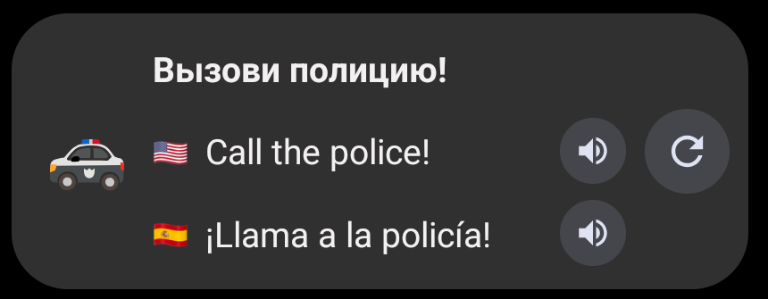
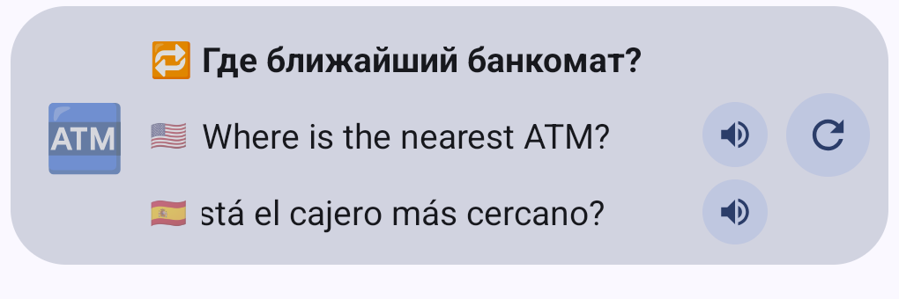
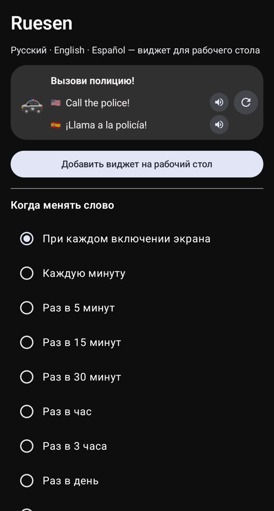

# Ruesen — RU · EN · ES

Виджет для рабочего стола Android: каждый раз, когда вы берёте телефон, показывает новое слово или короткую фразу сразу на трёх языках — русском, английском и испанском — и умеет произносить их вслух.

<p align="center">
  
  
</p>

## Возможности

- **Тройки переводов** — русский, английский и испанский в одном виджете высотой 2 ячейки на всю ширину экрана.
- **Новое слово при включении экрана** — или по таймеру: каждую минуту, раз в 5/15/30 минут, раз в час, раз в 3 часа, раз в день, либо только вручную.
- **Озвучка** — кнопки 🔊 у английской и испанской строк. Акцент на выбор: американский или британский английский, испанский Испании или Латинской Америки.
- **Слова и фразы по очереди** — после слова показывается фраза, потом снова слово.
- **Emoji** — у слов, для которых есть понятная картинка (🏠 дом, 💧 вода, 🐕 собака…).
- **Повторения** — часть карточек повторяет уже показанное через растущие интервалы: 30 минут → 4 часа → 1 день → 3 → 7 → 21 → 60 дней. Такие карточки помечены 🔁.
- **Бегущая строка** — если фраза не помещается по ширине, она плавно прокручивается.
- **Кнопка ↻** — сразу показать другую карточку.
- **Цвета Material You** — виджет подстраивается под обои и тему телефона.

## Словарь

Встроенная тестовая база: **500 самых употребительных слов** и **100 повседневных фраз**.

| | Что внутри |
|---|---|
| Слова | местоимения, предлоги, числа, дни недели, 106 глаголов, 70 прилагательных и цветов, 185 существительных (еда, тело, дом, природа, транспорт, профессии) |
| Фразы | приветствия и вежливость, «не понимаю / повторите», город и транспорт, кафе, покупки, самочувствие, время, реакции |

Испанские существительные даны с артиклем (`la casa`, `el agua`), чтобы сразу запоминать род. Испанский вариант — европейский, как и голос по умолчанию.

Файлы базы — `app/src/main/assets/words.tsv` и `phrases.tsv`, по строке на карточку:

```
emoji	ru	en	es
🏠	дом	house	la casa
```

Добавить слова можно прямо в эти файлы — прогресс изучения привязан к английскому слову, поэтому порядок строк менять безопасно.

## Установка

1. Скачайте `Ruesen.apk` из раздела [Releases](https://github.com/tripolskiydigital/ruesen/releases) и установите его (Android 12 и новее).
2. Добавьте виджет «Ruesen» на рабочий стол из списка виджетов лаунчера или кнопкой «Добавить виджет» в приложении.
3. Откройте приложение, чтобы выбрать частоту смены, повторения и акценты.

Для озвучки нужен синтез речи Google с голосами английского и испанского. Если голоса нет, приложение подскажет, где его установить: «Настройки → Специальные возможности → Синтез речи».



## Как это устроено

- **Смена при включении экрана.** Android сообщает о включении экрана только приложениям, которые работают в этот момент. Поэтому, пока виджет стоит на рабочем столе, запущен лёгкий фоновый сервис, который ничего не делает до включения экрана. Разрешение на уведомления приложение не запрашивает, поэтому в шторке сервис не виден. В режиме «Только кнопкой ↻» сервис не запускается.
- **Таймер** использует будильник, который не будит телефон: пока экран выключен, слово не меняется, а при включении меняется, если время уже прошло.
- **Размер.** Виджет занимает 5×2 ячейки в лаунчерах на основе Launcher3 (Pixel Launcher и др.) и 2 строки в лаунчерах, которые считают размер по `minWidth`/`minHeight`.
- **Бегущая строка.** Стандартная прокрутка текста в виджетах работает только для одной строки, поэтому прокрутка сделана анимацией: удвоенный текст сдвигается на половину своей ширины по кругу. Подходит ли текст, приложение заранее измеряет по ширине виджета.

## Сборка

Нужны JDK 17 и Android SDK 35.

```bash
./gradlew assembleRelease
```

APK появится в `app/build/outputs/apk/release/`. Release-сборка подписана отладочным ключом — этого достаточно для установки на свой телефон.

Стек: Kotlin, RemoteViews для виджета, Jetpack Compose + Material 3 для экрана настроек, системный TextToSpeech.

## Лицензия

[Apache License 2.0](LICENSE)
